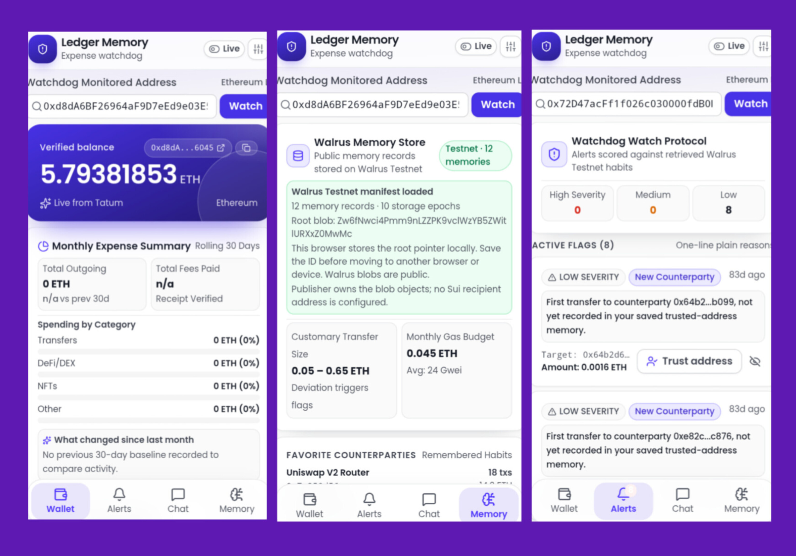

# Ledger Memory – Crypto Expense Watchdog

  

  
  &nbsp;&nbsp;
  
  &nbsp;&nbsp;
  

**A mobile-first crypto expense watchdog that actually remembers its user.**

Built primarily with [Tatum AI Builder](https://dashboard.tatum.io/ai-builder/crypto-expense-watchdog-644bf1?logged=true&productId=6a95cab64eeb5d2dc302a88b&chat=ses_e9062af70ffeuI6OQT24dGnhQS) for the **Tatum × Walrus Total Recall Hackathon** (Consumer Finance Apps track).

---

## Problem

Most crypto portfolio and expense tools are stateless.  
They show you balances and transactions, but they forget everything the moment you close the tab.

They don’t know:
- What your normal transfer sizes look like
- Which addresses you usually interact with
- Your typical gas habits
- Whether a new transaction is actually unusual for *you*

Ledger Memory fixes this by combining **Tatum’s real-time on-chain data** with **Walrus Memory** so the app learns your habits over time and gets smarter.

---

## What it does

- **Watch any Ethereum wallet** in real time via Tatum Data API
- Shows verified balance + rolling 30-day expense summary
- Categorizes spending (Transfers / DeFi-DEX / NFTs / Other)
- **Watchdog Alerts** scored against your remembered habits
- **Memory Chat** that answers questions using your personal transaction history and patterns
- Stores and verifies synthetic memory records on **Walrus Testnet**; the authenticated Mainnet publishing path is being prepared for deployment and funding.

### Screens

| Screen     | Purpose                                      |
|------------|----------------------------------------------|
| Wallet     | Live balance, expense summary, recent txs    |
| Alerts     | Anomaly detection with plain-language reasons|
| Chat       | Conversational interface powered by memory   |
| Memory     | View stored habits & patterns                |

---

## How it uses Tatum + Walrus

**Tatum**
- Real-time balance & transaction history via Tatum Data API
- Live data feeds power the Wallet and Alerts screens

**Walrus Memory**
- Stores your usual transfer sizes
- Remembers trusted counterparties
- Learns gas / fee patterns
- Builds a personal baseline so the watchdog can detect real anomalies

The product improves the more you use it. After enough activity the “What changed since last month” section and the alert scoring become meaningful.

---

## Current Status (Hackathon Build)

- Live monitoring of a real high-value ETH hot wallet
- Tatum live data integration working
- Basic expense categorization live
- Walrus Testnet memory initialization verified (12 records, manifest and readback)
- Chat + Alerts UI ready

> Note: This project was generated and iterated primarily through Tatum AI Builder (limited free prompts), then pushed to GitHub.

---

## Tech Stack

- Tatum AI Builder (primary development environment)
- Tatum Data API / RPC
- Walrus Memory (Testnet verified; authenticated Mainnet publishing path prepared)
- React + TypeScript + Tailwind (generated frontend)
- Mobile-first UI

---

## Why this fits the Consumer Finance track

This is a practical money product people would actually open daily:
- Expense tracking
- Habit learning
- Anomaly protection
- Blockchain stays mostly invisible
- The product gets better the more it remembers you

It also competes for the **Best Tatum AI Builder** special award.

---

## Roadmap (post-hackathon)

- Stronger baseline generation
- Multi-wallet support
- Smarter category detection
- Deeper chat reasoning over long-term memory
- Notification channels (Telegram / email)

---

## Author

Chokri (@chokri29)

Built for the Tatum × Walrus Total Recall Hackathon – November 2026

---

## Environment variables (Vercel / local)

| Variable | Required | Purpose |
|----------|----------|---------|
| `TATUM_API_KEY` | Yes | Live balance & transactions |
| `VITE_CLERK_PUBLISHABLE_KEY` | Optional | Enable signup / login wall |
| `WALRUS_NETWORK` | Optional | `testnet` (default) or `mainnet` |
| `WALRUS_PUBLISHER_URL` | Mainnet | HTTPS URL of your private authenticated publisher |
| `WALRUS_AGGREGATOR_URL` | Optional | Aggregator for reads; Mainnet defaults to the public Mainnet aggregator |
| `WALRUS_MEMORY_EPOCHS` | Optional | Storage epochs (default 10; bounded by the backend) |
| `WALRUS_JWT_SECRET` | Mainnet | 32+ character shared secret; must match publisher JWT verification secret |
| `WALRUS_MAINNET_ADMIN_TOKEN` | Mainnet | Separate random 32+ character operator token; never expose as a Vite variable |
| `WALRUS_SUI_OWNER_ADDRESS` | Optional | Sui address to receive created blob objects |

### Seed ≥10 Walrus memories

Open the Memory tab and initialize the 12 synthetic demo records. The app uses a resumable sequence of plan, record, snapshot, and finalization requests; the browser checkpoints each returned blob ID so a retry can resume safely.

For Mainnet, follow [`ops/walrus-publisher/README.md`](./ops/walrus-publisher/README.md) to deploy a private authenticated publisher, then configure the Mainnet Vercel environment variables. Mainnet writes require a short-lived operator session in the Memory tab and a funded publisher wallet. A configured endpoint alone does not prove that the publisher is online or funded.

---

## Walrus Mainnet publishing status

The application supports a private authenticated Mainnet publisher using short-lived HS256 JWTs. The operator token is exchanged for a 15-minute HttpOnly, SameSite=Strict cookie; it is not written to localStorage or embedded in the frontend build.

The Mainnet publisher is a separate service and must be deployed with a dedicated Sui wallet. It requires both SUI for gas and WAL for storage. The repository contains a provider-neutral Linux/systemd and Nginx deployment package under [`ops/walrus-publisher/`](./ops/walrus-publisher/).

**Current verified storage milestone:** 12 synthetic records on Walrus Testnet. Mainnet deployment, wallet funding, and a successful Mainnet write are separate milestones and must not be represented as completed until verified.
