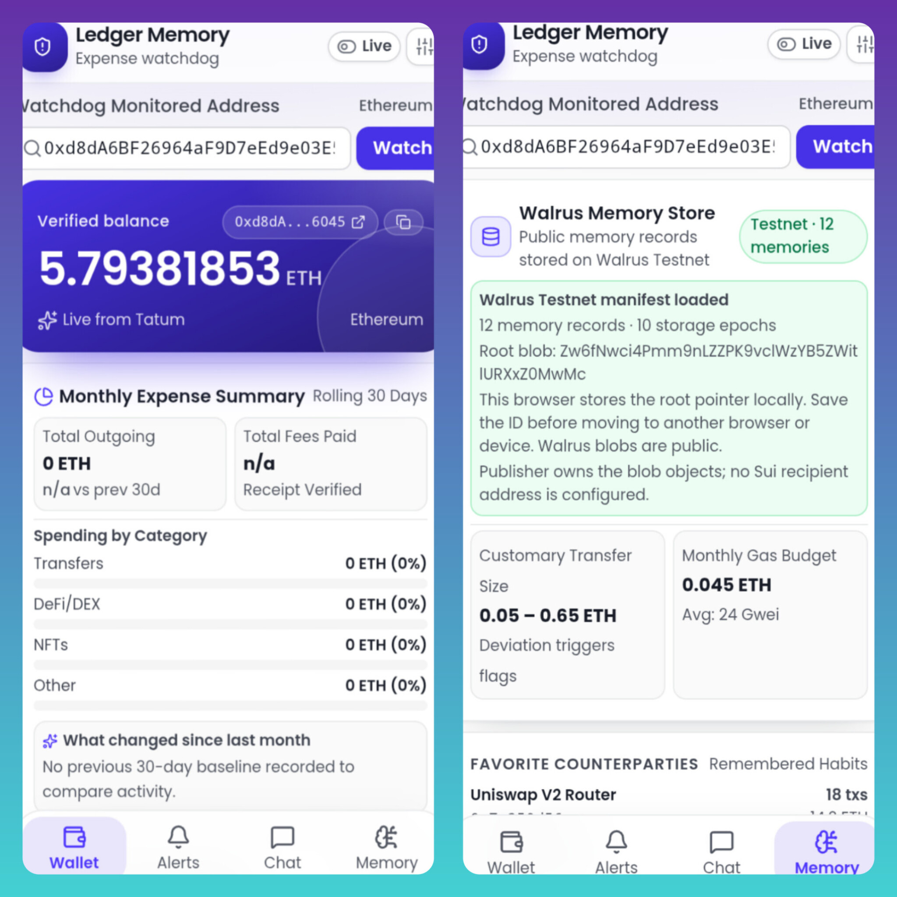

# Ledger Memory – Crypto Expense Watchdog

<p align="center">
  
</p>

<p align="center">
  <a href="https://crypto-expense-watch.vercel.app/">
    
  </a>
  &nbsp;&nbsp;
  <a href="./LICENSE">
    
  </a>
  &nbsp;&nbsp;
  <a href="https://github.com/chokri29/Crypto-Review-Lab/actions">
    
  </a>
</p>

**A mobile-first crypto expense watchdog that actually remembers its user.**

Built primarily with [Tatum AI Builder](https://dashboard.tatum.io/ai-builder/crypto-expense-watchdog-644bf1?logged=true&productId=6a95cab64eeb5d2dc302a88b&chat=ses_e9062af70ffeuI6OQT24dGnhQS) for the **Tatum × Walrus Total Recall Hackathon** (Consumer Finance Apps track).

---

## Problem

Most crypto portfolio and expense tools are stateless.  
They show you balances and transactions, but they forget everything the moment you close the tab.

They don’t know:
- What your normal transfer sizes look like
- Which addresses you usually interact with
- Your typical gas habits
- Whether a new transaction is actually unusual for *you*

Ledger Memory fixes this by combining **Tatum’s real-time on-chain data** with **Walrus Memory** so the app learns your habits over time and gets smarter.

---

## What it does

- **Watch any Ethereum wallet** in real time via Tatum Data API
- Shows verified balance + rolling 30-day expense summary
- Categorizes spending (Transfers / DeFi-DEX / NFTs / Other)
- **Watchdog Alerts** scored against your remembered habits
- **Memory Chat** that answers questions using your personal transaction history and patterns
- All memories are stored on **Walrus Mainnet**

### Screens

| Screen     | Purpose                                      |
|------------|----------------------------------------------|
| Wallet     | Live balance, expense summary, recent txs    |
| Alerts     | Anomaly detection with plain-language reasons|
| Chat       | Conversational interface powered by memory   |
| Memory     | View stored habits & patterns                |

---

## How it uses Tatum + Walrus

**Tatum**
- Real-time balance & transaction history via Tatum Data API
- Live data feeds power the Wallet and Alerts screens

**Walrus Memory**
- Stores your usual transfer sizes
- Remembers trusted counterparties
- Learns gas / fee patterns
- Builds a personal baseline so the watchdog can detect real anomalies

The product improves the more you use it. After enough activity the “What changed since last month” section and the alert scoring become meaningful.

---

## Current Status (Hackathon Build)

- Live monitoring of a real high-value ETH hot wallet
- Tatum live data integration working
- Basic expense categorization live
- Walrus Memory integration in place (memories being written on Mainnet)
- Chat + Alerts UI ready

> Note: This project was generated and iterated primarily through Tatum AI Builder (limited free prompts), then pushed to GitHub.

---

## Tech Stack

- Tatum AI Builder (primary development environment)
- Tatum Data API / RPC
- Walrus Memory (Mainnet)
- React + TypeScript + Tailwind (generated frontend)
- Mobile-first UI

---

## Why this fits the Consumer Finance track

This is a practical money product people would actually open daily:
- Expense tracking
- Habit learning
- Anomaly protection
- Blockchain stays mostly invisible
- The product gets better the more it remembers you

It also competes for the **Best Tatum AI Builder** special award.

---

## Roadmap (post-hackathon)

- Stronger baseline generation
- Multi-wallet support
- Smarter category detection
- Deeper chat reasoning over long-term memory
- Notification channels (Telegram / email)

---

## Author

Chokri (@chokri29)

Built for the Tatum × Walrus Total Recall Hackathon – November 2026

---

## Environment variables (Vercel / local)

| Variable | Required | Purpose |
|----------|----------|---------|
| `TATUM_API_KEY` | Yes | Live balance & transactions |
| `VITE_CLERK_PUBLISHABLE_KEY` | Optional | Enable signup / login wall |
| `WALRUS_PUBLISHER_URL` | For Mainnet | e.g. Mainnet publisher URL |
| `WALRUS_AGGREGATOR_URL` | Optional | Aggregator for reads |
| `WALRUS_EPOCHS` | Optional | Blob storage epochs (default 5) |

### Seed ≥10 Walrus memories

After deploy, call once:

```
POST /api/tatum/memory/seed
```

Or open the Memory tab — the first load will auto-seed. Check `publishedCount` and `blobId` fields in the response.

For **Mainnet**, set `WALRUS_PUBLISHER_URL` to the Mainnet publisher endpoint in Vercel env vars and redeploy, then hit `/api/tatum/memory/seed` again.

---

## Walrus Mainnet owner wallet

Configured Sui address (will own blob objects when Mainnet writes are enabled):

```
0x66ef4fe9c04d9da0f1645d7255774aed557d27ebc2c59da1049c6757ee9cec65
```

Override with env: `SUI_MEMORY_OWNER`

### Current write path
- **Now:** public **Testnet** publisher (works without funds)
- **After refill:** set `WALRUS_PUBLISHER_URL` to a Mainnet-capable path (private publisher or funded upload flow) and re-run `POST /api/tatum/memory/seed`

Every published memory payload includes this owner address and uses `send_object_to` when the publisher supports it.
